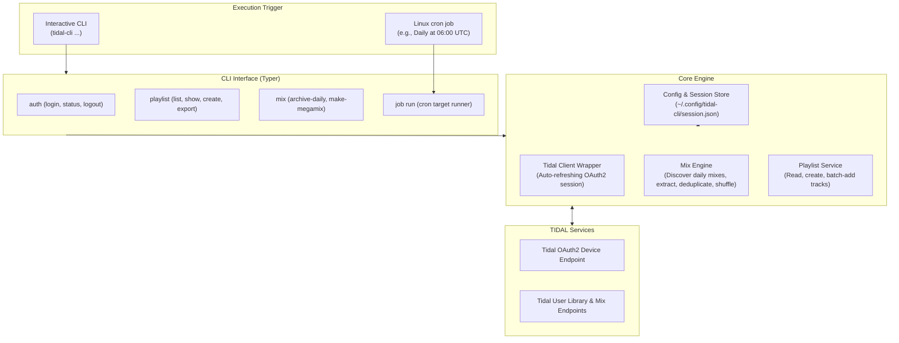
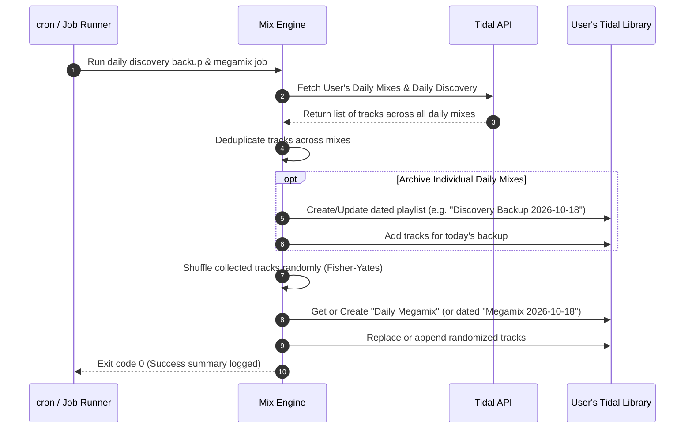

# Tidal Schedulable CLI Client Architecture & Implementation Plan

## 1. Executive Summary

This specification defines the architecture, design, and implementation roadmap for **`tidal-cli`**—a lightweight, headless-friendly Command Line Interface tailored for automated execution via `cron` on a Linux server (as well as interactive local use).

The primary immediate automation routine is:
1. **Archiving Daily Discovery / Daily Mixes**: Capturing daily algorithmic mixes before they expire/refresh.
2. **Generating a Randomized Megamix**: Aggregating all discovered tracks into a single, deduplicated, shuffled "Daily Megamix" playlist.
3. **Extensibility**: Providing a modular pipeline for additional automated playlist synthesis and synchronization jobs in the future.

---

## 2. Technical Stack & Environment

| Layer | Selection | Rationale |
| :--- | :--- | :--- |
| **Language & Runtime** | Python 3.12+ (tested on Python 3.14) | Robust typing, cross-platform, extensive standard library. |
| **Package Manager** | `uv` | Instant virtual environments, reproducible lockfiles, fast execution (`uv run`). |
| **CLI Framework** | `typer` + `rich` | Intuitive command parsing, non-interactive flag support (`--quiet`, `--json`), elegant terminal output. |
| **Tidal Integration** | `python-tidal` (`tidalapi`) | Reliable OAuth2 Device Flow, user session management, playlist/track endpoints. |
| **Configuration & Storage** | Local config file (`~/.config/tidal-cli/`) | Headless server-safe (`session.json` + `config.yaml` / `jobs.yaml`), no D-Bus or GUI keyring dependency, `chmod 0600` permissions. |
| **Scheduling** | Linux `cron` | Standard, rock-solid server scheduling with comprehensive logging and error exit codes. |

---

## 3. High-Level Architecture



---

## 4. Key Workflows & Functional Design

### 4.1 Authentication & Headless Server Flow
On headless Linux servers, graphical browser popups are unavailable. The client leverages Tidal's **OAuth2 Device Authorization Flow**:
1. Run interactive `tidal auth login`:
   - Prints: `Go to https://link.tidal.com/XXXXX to authorize your device`.
   - Polls Tidal until authorized.
2. Saves tokens in `~/.config/tidal-cli/session.json`:
   - Enforces restrictive file permissions (`chmod 0600`) so other users on the server cannot read the token.
   - Contains: `session_id`, `token_type`, `access_token`, `refresh_token`, and `expiry_time`.
3. Unattended runs:
   - When executed by `cron`, the client checks token expiration and automatically calls `refresh_token` if needed, persisting the updated token back to `session.json`.

### 4.2 Daily Discovery Archiving & Megamix Pipeline

The core automated workflow executes as follows:



1. **Locate Daily Mixes**: Dynamically queries the user's algorithmic mix modules (`My Daily Discovery` and any dynamic count of `Daily Mix` lists—which can range from 1 to 8+ depending on listening history).
2. **Track Extraction**: Extracts track IDs and metadata.
3. **Deduplication**: Filters out duplicate track entries across different mixes.
4. **Archive Playlist**: Creates a dated archive playlist (e.g., `Discovery Backup - 2026-10-18`) so the ephemeral tracks are permanently saved.
5. **Randomized Megamix Creation**:
   - Collects all tracks from today's mixes.
   - Applies random shuffle.
   - Creates or updates the target playlist (e.g., `Daily Megamix` or `Daily Megamix - 2026-10-18`).
   - Populates tracks in batches (respecting Tidal's API batch limits).

### 4.3 Extensible Job Definition (`jobs.yaml`)
To allow adding future automated tasks without code modifications, workflows are declaratively defined:
```yaml
config:
  log_file: "~/.config/tidal-cli/tidal-cli.log"
  log_level: "INFO"

jobs:
  daily-discovery-sync:
    description: "Backup daily discovery and create a randomized megamix"
    actions:
      - action: backup_daily_discovery
        params:
          playlist_name_format: "Discovery Backup - {date}"
          description: "Automated daily backup of Tidal Daily Discovery"
      - action: create_megamix
        params:
          sources: ["daily_discovery", "daily_mixes"]
          target_playlist: "Daily Megamix"
          mode: "replace" # or "append"
          shuffle: true
          limit: 100
          description: "All daily mix tunes in random order - generated on {date}"
```

---

## 5. CLI Command Surface

```text
tidal [OPTIONS] COMMAND [ARGS]...

Global Options:
  --config PATH       Path to session/config directory [default: ~/.config/tidal-cli]
  --quiet, -q         Suppress decorative terminal output (for cron)
  --json              Output structured JSON for piping/log collection

Commands:
  auth
    login             Initiate interactive OAuth2 device authorization
    status            Display active user, subscription tier, and token expiration
    logout            Wipe stored local session tokens

  playlist
    list              List user-created and favorited playlists
    show <id|name>    Display tracks and metadata in a playlist
    create <name>     Create a new empty or populated playlist
    export <id|name>  Export playlist to JSON, M3U8, or CSV

  mix
    daily-backup      Archive current Daily Discovery / Daily Mixes to a playlist
    megamix           Generate a randomized megamix from daily mixes
                      Options: --target <name> --shuffle / --no-shuffle --replace / --append

  job
    run <job_name>    Execute a declared job from jobs.yaml (cron entrypoint)
    list              Show all declared jobs in jobs.yaml
    cron-help         Display ready-to-copy crontab line for server setup
```

---

## 6. Implementation Plan & Milestones

### Phase 1: Environment & Project Setup
- [ ] Initialize Python project using `uv` with `pyproject.toml`.
- [ ] Add dependencies: `tidalapi`, `typer[all]`, `rich`, `pydantic`, `pyyaml`.
- [ ] Set up package directory structure under `src/tidal_cli/`.

### Phase 2: Configuration & Session Management
- [ ] Implement `config.py` to handle `~/.config/tidal-cli/` creation and 0600 permissions.
- [ ] Implement `auth.py` wrapping `tidalapi.Session`:
  - Device flow login (`login_oauth_simple` / device code URL output).
  - Session serializer & deserializer (`session.json`).
  - Auto-refresh token verification check before every command.
- [ ] Implement CLI `auth` commands (`login`, `status`, `logout`).

### Phase 3: Playlist Inspection & Creation
- [ ] Implement `services/playlist_service.py`:
  - Fetch user playlists, pagination, and track lists.
  - Create new playlist with title and description.
  - Batch add tracks (chunked to prevent HTTP payload timeouts).
- [ ] Implement CLI `playlist` commands (`list`, `show`, `create`, `export`).

### Phase 4: Daily Mix Archiving & Randomized Megamix Engine
- [ ] Implement `services/mix_service.py`:
  - Discover user's daily mix modules (`session.user.favorites` / mixes / daily discovery).
  - Extract tracks across mixes, deduplicate by track ID or ISRC.
  - Implement randomized shuffling.
  - Create dated backup playlist and target "Daily Megamix".
- [ ] Implement CLI `mix` commands (`daily-backup`, `megamix`).

### Phase 5: Headless Job Engine & Cron Integration
- [ ] Implement `services/job_runner.py` for reading `jobs.yaml` and running sequential actions.
- [ ] Implement `job run <name>` with proper exit codes (0 = success, 1+ = error) and rotating file logger.
- [ ] Implement `job cron-help` displaying exact `crontab -e` lines using `uv run` or installed binary.

### Phase 6: Testing & Verification
- [ ] Unit tests for session persistence, deduplication, and shuffle logic.
- [ ] Mocked tests for Tidal API calls.
- [ ] Verification of headless execution flags (`--quiet`, `--json`).
