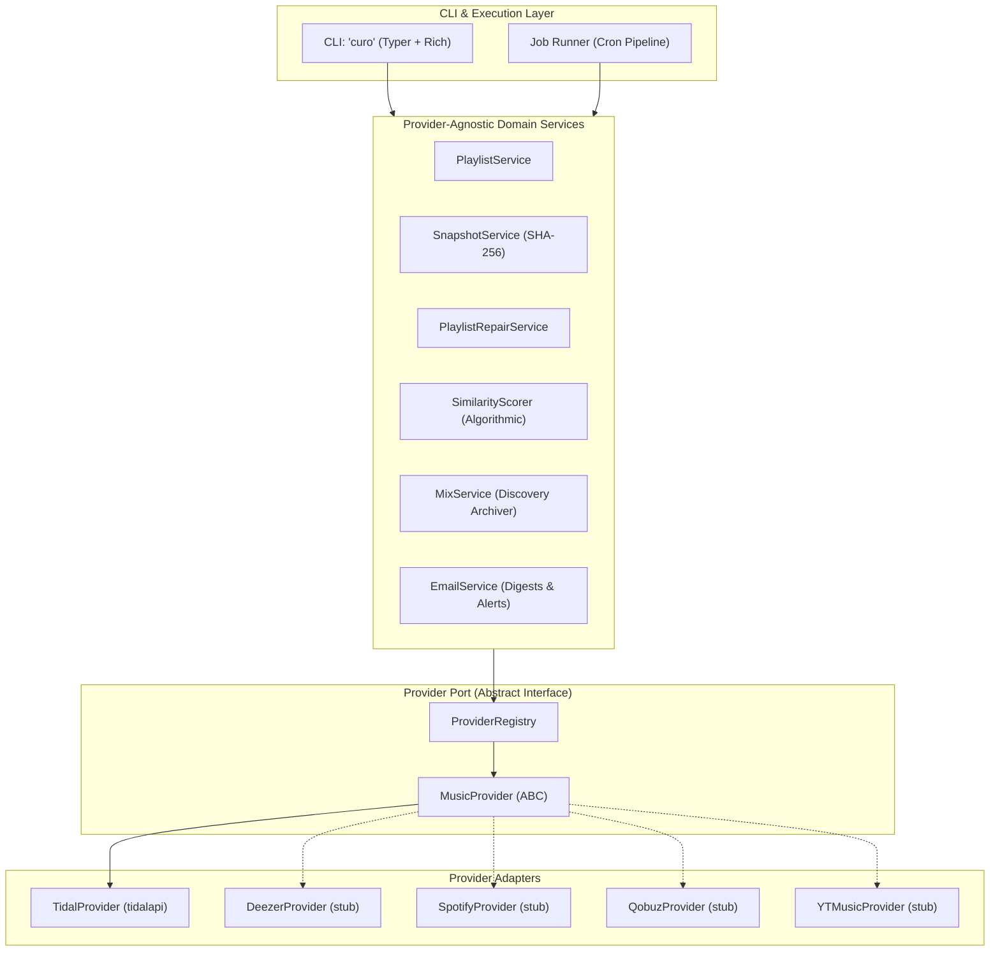

# Modular Architecture Plan: Musicae Curo (`curo`)

## Executive Summary
This architectural refactoring transforms the single-vendor `tidal-cli` into **Musicae Curo** (executable: `curo`), a modular, provider-agnostic music collection custodian.

- **Identity**: **Musicae Curo** ("I care for / heal music") with CLI executable **`curo`**.
- **Scope**: Clean break (no legacy aliases or backward compatibility shims needed since the project is unreleased).
- **Goal**: Full separation of concerns using Clean/Hexagonal Architecture so that:
  1. Core services (playlist management, mix archiving, snapshot versioning, catalog health checks, explainable repair, manual track substitution, email digests, schedulers) operate exclusively on provider-agnostic domain models.
  2. Any streaming service (**Tidal, Deezer, Qobuz, Spotify, Amazon Music, YouTube Music**) implements a standardized `MusicProvider` interface.
  3. Tidal is refactored into the first concrete provider adapter.

---

## 1. Project Identity & Package Layout

- **Project Name**: `musicae-curo` (Display: **Musicae Curo**)
- **CLI Executable**: `curo`
- **Default Config Directory**: `~/.config/curo/` (with `config.json`, `jobs.yaml`, `snapshots/`, `reports/`)
- **Python Package**: `src/curo/`

```
src/curo/
├── __init__.py
├── cli.py                     # Root CLI entrypoint (Typer + Rich)
├── config.py                  # Multi-provider configuration manager
├── core/                      # Pure domain layer (zero external music API dependencies)
│   ├── __init__.py
│   ├── models.py              # Track, Album, Artist, Playlist, CuratedMix
│   ├── provider.py            # MusicProvider abstract base class (SPI)
│   └── registry.py            # ProviderRegistry (discovery and instantiation)
├── providers/                 # Concrete provider implementations
│   ├── __init__.py
│   ├── base.py                # Shared adapter utilities
│   ├── tidal/                 # Tidal provider adapter
│   │   ├── __init__.py
│   │   ├── adapter.py         # TidalProvider (implements MusicProvider via tidalapi)
│   │   └── session.py         # Tidal OAuth authentication
│   ├── deezer/                # Deezer provider stub (future)
│   ├── spotify/               # Spotify provider stub (future)
│   ├── qobuz/                 # Qobuz provider stub (future)
│   └── ytmusic/               # YouTube Music provider stub (future)
└── services/                  # Business logic services (provider-agnostic)
    ├── __init__.py
    ├── playlist_service.py    # Playlist CRUD & export (M3U8, JSON, CSV)
    ├── snapshot_service.py    # SHA-256 versioning, history manifests, track registry
    ├── playlist_repair.py     # Repair orchestrator & candidate evaluation
    ├── candidate_finder.py    # Multi-strategy search orchestrator via active provider
    ├── similarity_scorer.py   # Explainable 100-pt scoring engine
    ├── track_matcher.py       # Title normalization & string similarity algorithms
    ├── mix_service.py         # Curated/discovery mix archiving & updates
    ├── email_service.py       # SMTP digest notifications & HTML templates
    └── job_runner.py          # Unified cron/scheduled execution pipeline
```

---

## 2. Target Architecture (Ports & Adapters)



---

## 3. Core Domain Models (`src/curo/core/models.py`)

Every entity is a clean Pydantic model. No domain service or CLI command interacts with vendor-specific SDK classes:

```python
from __future__ import annotations
from datetime import datetime, date
from typing import Any, Dict, List, Optional
from pydantic import BaseModel, Field


class Artist(BaseModel):
    id: str
    name: str
    provider: str


class Album(BaseModel):
    id: str
    title: str
    provider: str
    upc: Optional[str] = None
    release_date: Optional[str] = None
    artists: List[Artist] = Field(default_factory=list)


class Track(BaseModel):
    id: str
    title: str
    provider: str
    duration_seconds: int
    artist: Artist
    collaborating_artists: List[Artist] = Field(default_factory=list)
    album: Optional[Album] = None
    isrc: Optional[str] = None
    available: bool = True
    allow_streaming: bool = True
    stream_ready: bool = True


class Playlist(BaseModel):
    id: str
    title: str
    provider: str
    description: Optional[str] = ""
    is_public: bool = False
    is_owner: bool = True
    track_count: int = 0
    duration_seconds: int = 0
    updated_at: Optional[datetime] = None


class CuratedMix(BaseModel):
    id: str
    title: str
    sub_title: Optional[str] = None
    provider: str
    mix_type: str  # e.g., "daily_discovery", "weekly_exploration", "curated_mix"
    track_count: int = 0
```

---

## 4. Standard Provider Port (`src/curo/core/provider.py`)

The contract implemented by every streaming service adapter:

```python
from abc import ABC, abstractmethod
from typing import Any, Dict, List, Optional
from curo.core.models import Album, CuratedMix, Playlist, Track


class MusicProvider(ABC):
    """Abstract interface defining required capabilities for any music provider."""

    @property
    @abstractmethod
    def name(self) -> str:
        """Provider identifier (e.g. 'tidal', 'deezer', 'spotify')."""
        ...

    # --- Authentication & Status ---
    @abstractmethod
    def login(self) -> bool: ...

    @abstractmethod
    def logout(self) -> None: ...

    @abstractmethod
    def is_authenticated(self) -> bool: ...

    @abstractmethod
    def get_session_info(self) -> Dict[str, Any]: ...

    # --- Playlists ---
    @abstractmethod
    def get_user_playlists(self) -> List[Playlist]: ...

    @abstractmethod
    def get_playlist(self, identifier: str) -> Optional[Playlist]: ...

    @abstractmethod
    def get_playlist_tracks(self, playlist_id: str) -> List[Track]: ...

    @abstractmethod
    def create_playlist(self, title: str, description: str = "", is_public: bool = False) -> Playlist: ...

    @abstractmethod
    def add_tracks_to_playlist(
        self, playlist_id: str, track_ids: List[str], position: Optional[int] = None
    ) -> bool: ...

    @abstractmethod
    def remove_track_from_playlist_by_index(self, playlist_id: str, index: int) -> bool: ...

    # --- Curated & Discovery Mixes ---
    @abstractmethod
    def get_curated_mixes(self) -> List[CuratedMix]: ...

    @abstractmethod
    def get_mix_tracks(self, mix_id: str) -> List[Track]: ...

    # --- Catalog & Search ---
    @abstractmethod
    def get_track(self, track_id: str) -> Optional[Track]: ...

    @abstractmethod
    def get_tracks_by_isrc(self, isrc: str) -> List[Track]: ...

    @abstractmethod
    def get_albums_by_barcode(self, upc: str) -> List[Album]: ...

    @abstractmethod
    def get_album_tracks(self, album_id: str) -> List[Track]: ...

    @abstractmethod
    def search_tracks(self, query: str, limit: int = 10) -> List[Track]: ...
```

---

## 5. Configuration & Multi-Provider CLI

### Configuration (`~/.config/curo/config.json`)
```json
{
  "default_provider": "tidal",
  "providers": {
    "tidal": {
      "enabled": true,
      "session_file": "tidal_session.json"
    },
    "deezer": {
      "enabled": false
    },
    "spotify": {
      "enabled": false
    }
  },
  "smtp": {
    "host": "",
    "port": 587,
    "user": "",
    "password": "",
    "tls": true
  }
}
```

### Clean CLI Commands (`curo`)
The global `-p, --provider` option selects the provider (defaults to `default_provider` in config):
```bash
# Authenticate
curo auth login
curo auth login -p deezer

# Playlist operations
curo playlist list
curo playlist show "My Rotation"
curo playlist snapshot
curo playlist repair "My Rotation" --live
curo playlist replace "My Rotation" --track "#4" --with GBCEE0700017 --live

# Discovery mixes
curo mix list
curo mix daily
curo mix archive "Daily Discovery" --playlist "Discovery Archive"

# Notifications & Automation
curo notify test
curo notify send --all
curo job run-daily
curo job cron-help
```

---

## 6. Phased Implementation Roadmap


### Phase 1: Core Models & Provider Port
- Create `src/curo/core/models.py` (`Track`, `Album`, `Artist`, `Playlist`, `CuratedMix`).
- Create `src/curo/core/provider.py` (`MusicProvider` base class).
- Create `src/curo/core/registry.py` (`ProviderRegistry`).

### Phase 2: Tidal Adapter Isolation
- Create `src/curo/providers/tidal/adapter.py`: Implements `MusicProvider`, wrapping `tidalapi`.
- Create `src/curo/providers/tidal/session.py`: Handles Tidal OAuth token storage & refresh.
- Ensures all `tidalapi` imports live exclusively inside `src/curo/providers/tidal/`.

### Phase 3: Service Refactoring
- Refactor `PlaylistService`, `MixService`, `SnapshotService`, `PlaylistRepairService`, `CandidateFinder`, `JobRunner` to accept `provider: MusicProvider`.
- Maintain `SimilarityScorer` and `TrackMatcher` as pure, high-performance string/metadata algorithms.

### Phase 4: Provider Stubs
- Add stub adapters with clear documentation for:
  - `src/curo/providers/deezer/`
  - `src/curo/providers/spotify/`
  - `src/curo/providers/qobuz/`
  - `src/curo/providers/ytmusic/`

### Phase 5: CLI & Package Setup
- Update `pyproject.toml`: package name `musicae-curo`, executable `curo = "curo.cli:app"`.
- Implement clean `curo` CLI with `-p, --provider` option.
- Update config storage to `~/.config/curo/`.

### Phase 6: Test Suite & Documentation
- Update all 63 unit and integration tests to use the new `curo` architecture.
- Rewrite `README.md` and `DOCUMENTATION.md` for **Musicae Curo** (`curo`).
