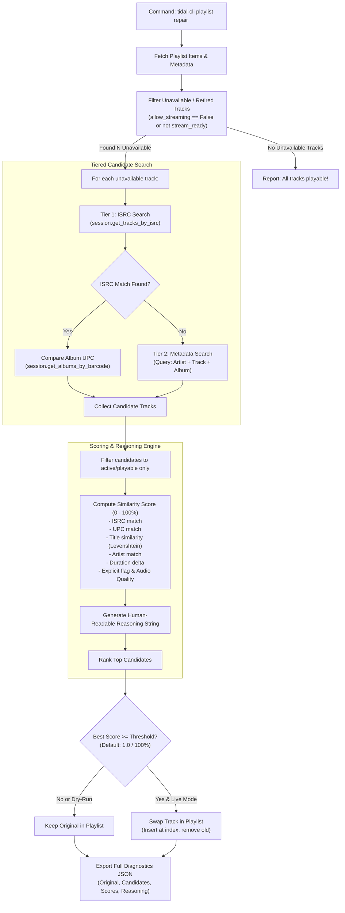

# Tidal Playlist Track Repair & Replacement Architecture Plan

## 1. Executive Summary

Streaming services like TIDAL regularly retire and re-license catalog releases. When this occurs, tracks from defunct releases remain in user playlists in an unplayable, unavailable state (`allow_streaming: false`, missing stream URLs, or grayed out). 

This plan details the design and implementation of an automated **Playlist Repair & Track Replacement Engine** for `tidal-cli`. The engine locates retired/unavailable tunes in existing playlists, searches for active substitute releases using a tiered heuristic (ISRC + UPC matching, progressing to fuzzy metadata similarity), calculates a transparent similarity score with explainable reasoning, and exports candidate diagnostics to JSON.

Per initial requirements, the system starts with a **100% threshold (dry-run baseline)** so no playlist content is mutated on TIDAL until candidate analysis and scoring heuristics are calibrated and confirmed.

---

## 2. System Architecture & Replacement Workflow



---

## 3. Detailed Component Design

### 3.1 Unavailable Track Detection (`detection.py`)
In TIDAL's catalog API, unavailable tracks exhibit specific markers:
- `track.available == False` or `track.allow_streaming == False`
- `track.stream_ready == False`
- `track.stream_start_date is None` (often cleared on de-listed tracks)
- Network probe (optional fallback): HEAD request on audio stream url returning `404` or `403`

The detection module extracts both the track attributes and its position index within the playlist.

### 3.2 Tiered Candidate Search Strategy (`resolver.py`)
To find replacement candidates for an unavailable track, the resolver follows a prioritized cascade:

1. **Tier 1 — Exact Recording Match via ISRC (`get_tracks_by_isrc`)**:
   - Queries Tidal OpenAPI v2 for tracks sharing the exact same ISRC (`filter[isrc]=...`).
   - If found, checks each candidate's parent album barcode/UPC against the original album's UPC.
   - An identical ISRC + identical UPC indicates the identical release re-ingested under a new catalog ID.
2. **Tier 2 — Exact Recording on Reissue/Compilation**:
   - Matches the same ISRC on a new release, deluxe edition, remaster, or anthology.
3. **Tier 3 — Best-Effort Title & Artist Search (`session.search`)**:
   - If no ISRC match is available (or ISRC was stripped), searches using:
     - Exact query: `"{artist_name} {clean_track_title}"`
     - Clean title normalizer: strips noise like `(Remastered 2011)`, `- Single Version`, `(feat. ...)`.
   - Fetches top 10 search hits and filters for playable tracks.

### 3.3 Similarity Scoring & Reasoning Engine (`scorer.py`)
Each active candidate track is evaluated against the unavailable original across multiple dimensions, producing a composite score $S \in [0.0, 1.0]$:

| Dimension | Weight | Scoring Logic |
| :--- | :--- | :--- |
| **ISRC Match** | 40% | Exact match = 40 pts; mismatch / missing = 0 pts. |
| **Album UPC Match** | 20% | Both albums share identical UPC barcode = 20 pts. |
| **Title Similarity** | 15% | Normalized fuzzy ratio (Levenshtein distance). Exact normalized title = 15 pts. |
| **Artist Similarity** | 10% | Primary artist ID match = 10 pts; exact name match = 8 pts. |
| **Duration Delta** | 10% | $\Delta \le 1\text{s}$: 10 pts; $\Delta \le 3\text{s}$: 8 pts; $\Delta \le 7\text{s}$: 4 pts; $\Delta > 15\text{s}$: 0 pts. |
| **Album Name Match** | 5% | Same album title = 5 pts. |
| **Version Mismatch Penalty** | Severe (-50% to -60%) | If original is studio, candidates containing 'Live', 'Acoustic', 'Remix', or 'Instrumental' receive heavy penalties (capping score <= 40%). Marked with `requires_manual_approval: true` and only considered if no studio substitutes exist. |
| **Disqualification** | Reject | Karaoke, tribute, or generic cover artists are filtered out. |

#### Explainable Reasoning Generator
For every evaluated candidate, the engine constructs a human-readable explanation explaining why the candidate was rated as it was:
- *Example 1 (Ideal)*: `"Score: 100%. Exact ISRC match (USSM18200001) and identical album UPC (07464381122). Duration matches within 0.4s. Studio album confirmed."`
- *Example 2 (Good Reissue)*: `"Score: 82%. Exact ISRC match (GBUM71029604), but album UPC differs ('Greatest Hits' compilation vs original 'A Night at the Opera'). Runtime identical."`
- *Example 3 (Fuzzy Match)*: `"Score: 68%. No ISRC available. Title and Artist match exactly. Runtime differs by +2.1s. Likely a newer digital remaster."`
- *Example 4 (Live/Acoustic Mismatch)*: `"Score: 35%. [HEAVILY PENALIZED] Candidate is a Live recording ('Live at Wembley') while original is a studio recording. Requires manual approval. Never substituted automatically."`

---

## 4. Diagnostics JSON Schema

When running `tidal-cli playlist repair <id> --export <path>`, the engine produces a structured JSON report designed for inspection and algorithm tuning:

```json
{
  "report_generated_at": "2026-10-18T13:46:00Z",
  "playlist_id": "d6b5e00b-c852-4a0e-bc43-85ec77665544",
  "playlist_name": "My Heavy Rotation",
  "total_tracks": 150,
  "unavailable_tracks_count": 3,
  "threshold_configured": 1.0,
  "replacements_applied": 0,
  "dry_run": true,
  "unavailable_tracks": [
    {
      "index_in_playlist": 14,
      "original_track": {
        "id": 1234567,
        "title": "Billie Jean",
        "artist": "Michael Jackson",
        "album": "Thriller",
        "duration_seconds": 294,
        "isrc": "USSM18200001",
        "album_upc": "07464381122",
        "status": "unavailable"
      },
      "candidate_count": 4,
      "best_candidate": {
        "id": 9876543,
        "title": "Billie Jean",
        "artist": "Michael Jackson",
        "album": "Thriller (25th Anniversary)",
        "duration_seconds": 294,
        "isrc": "USSM18200001",
        "album_upc": "88697233442",
        "similarity_score": 0.85,
        "meets_threshold": false,
        "reasoning": "Exact ISRC match (USSM18200001). Duration is identical (294s). Album is a verified reissue (Thriller 25th Anniversary), differing only in release UPC."
      },
      "all_candidates": [
        {
          "id": 9876543,
          "title": "Billie Jean",
          "artist": "Michael Jackson",
          "album": "Thriller (25th Anniversary)",
          "score": 0.85,
          "reasoning": "..."
        },
        {
          "id": 4455667,
          "title": "Billie Jean (Live at Wembley)",
          "artist": "Michael Jackson",
          "album": "Live at Wembley July 16, 1988",
          "score": 0.42,
          "reasoning": "Live version mismatch against studio original. Duration differs by +38s."
        }
      ]
    }
  ]
}
```

---

## 5. CLI Command Specification

```text
tidal-cli playlist repair [OPTIONS] IDENTIFIER

Arguments:
  IDENTIFIER                  Playlist ID or Playlist Name to analyze/repair

Options:
  --threshold FLOAT           Minimum similarity score (0.0 to 1.0) to perform replacement.
                              [default: 1.0 (never replace automatically)]
  --export PATH               Export complete candidate and replacement report to JSON.
                              [default: reports/repair_<playlist_slug>.json]
  --dry-run / --live          Run in simulation mode (default: --dry-run).
  --interactive, -i           Interactively prompt user to accept/reject candidates above score.
  --all-tracks                Check all tracks for newer master/reissue (not just unavailable).
  --quiet, -q                 Suppress decorative banners (cron-friendly).
```

---

## 6. Implementation Milestones

### Phase 1: Core Analysis & Detection
- Implement `tidal_cli.services.track_matcher`:
  - `is_track_available(track: Track) -> bool`
  - Normalization helpers: string cleaning, title sanitization, duration delta.
- Implement `tidal_cli.services.candidate_finder`:
  - ISRC lookup (`session.get_tracks_by_isrc`)
  - UPC verification (`session.get_albums_by_barcode`)
  - Metadata fallback search (`session.search`)

### Phase 2: Scoring Engine & Reasoning Generator
- Implement `tidal_cli.services.similarity_scorer`:
  - Multi-dimensional scoring formula ($0.0 - 1.0$)
  - Auto-generated diagnostic reasoning string.
  - Candidate ranking and filtering.

### Phase 3: Playlist Inspection & JSON Export
- Implement `tidal_cli.services.playlist_repair_service`:
  - Scan playlist for unavailable items.
  - Discover candidates and compute rankings.
  - Serialize full diagnostics report matching the schema above.

### Phase 4: CLI Command & Dry-Run Integration
- Add `tidal-cli playlist repair <id>` with default `--dry-run` and `--threshold 1.0`.
- Display summary table in terminal (unavailable tracks, best candidate, score).
- Save report JSON to user-specified path or default `./repair_report_<id>.json`.

### Phase 5: Verification & Calibration
- Unit test suite with mock unavailable tracks, exact ISRC/UPC hits, fuzzy hits, and non-matches.
- Verify JSON serializability and explainable reasoning strings.
- Prepare codebase for subsequent calibration with live user playlist data.
