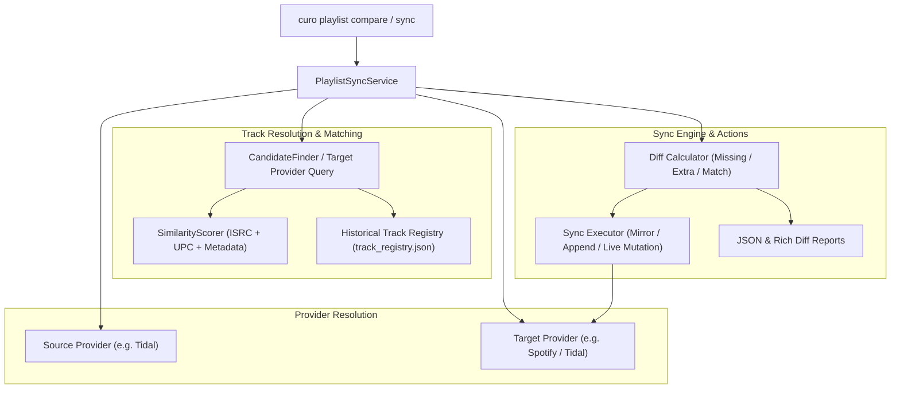

# Architecture & Implementation Plan: Cross-Provider Playlist Comparison and Synchronization

## Executive Summary

Musicae Curo was architected from the ground up as a provider-agnostic music custodian around the `MusicProvider` SPI. While playlist repair and discovery archiving currently operate within a single provider, this plan designs a **Cross-Provider Comparison and Synchronization Engine** (`PlaylistSyncService`).

This feature enables users to:
1. **Compare** two playlists across different streaming platforms (or within the same platform) and visualize track overlap, missing tracks, and platform-specific sound recordings.
2. **Synchronize** playlists one-way (`mirror` or `append`) or two-way (`merge`), automatically resolving matching sound recordings via universal sound codes (ISRC), album barcodes (UPC), and normalized fuzzy metadata scoring.
3. **Audit and preview** changes with dry-run reports before committing live mutations to streaming services.

---

## 1. Core Challenges & Technical Strategy

| Challenge | Impact | Technical Strategy |
| :--- | :--- | :--- |
| **Vendor Track IDs Differ** | A track on Tidal (`id: 534098519`) has a completely different identifier on Spotify (`id: 4u7EnebtmKWzUH433cf5Qv`). | **Universal Identity Layer**: Match tracks using ISRC codes first (+30 pts), Album UPCs second (+15 pts), and fallback to normalized `title + artist + duration` fuzzy evaluation with `curo.services.similarity_scorer`. |
| **Delisted / Incomplete Metadata** | Source track might lack ISRC or have stripped metadata if retired. | Query `SnapshotService.get_historical_track()` from `track_registry.json` to resurrect historical ISRC and release dates before searching target provider. |
| **Catalog Asymmetries** | Certain songs, remixes, or regional licenses exist on one provider but not the other. | Mark unresolvable tracks explicitly in diff reports (`status: unresolvable_in_target`), allowing partial syncs without failing the entire batch. |
| **Accidental Overwrites** | Unintended playlist wiping or duplicate spam. | **Dry-Run by Default**: Require explicit `--live` flag. Two-step chunked operations (50 tracks/batch) with safety checkpoints. |
| **Provider Availability** | Spotify/Deezer/Qobuz adapters are currently scaffolded stubs. | Design `PlaylistSyncService` to operate purely through the abstract `MusicProvider` interface. Fully testable via high-fidelity mock adapters and usable immediately between two playlists on Tidal or any active provider. |

---

## 2. High-Level Architecture & Component Flow



---

## 3. Detailed Design

### 3.1 Domain Model: Diff & Sync Entities (`curo.core.models` or `curo.services.playlist_sync_service`)

```python
class TrackMatchStatus(str, Enum):
    EXACT_ISRC = "exact_isrc"           # Direct sound recording match
    UPC_TRACK = "upc_track"             # Match from exact album barcode release
    METADATA_MATCH = "metadata_match"   # High-confidence fuzzy score >= threshold
    UNRESOLVED = "unresolved"           # No candidate meets threshold on target provider

class PlaylistDiffItem(BaseModel):
    source_index: Optional[int] = None
    source_track: Optional[Track] = None
    target_index: Optional[int] = None
    target_track: Optional[Track] = None
    match_status: TrackMatchStatus
    similarity_score: float = 0.0
    action: str  # "keep", "add_to_target", "remove_from_target", "unresolvable"

class PlaylistDiffReport(BaseModel):
    source_provider: str
    source_playlist: str
    target_provider: str
    target_playlist: str
    source_total: int
    target_total: int
    matches_count: int
    missing_in_target_count: int
    extra_in_target_count: int
    unresolvable_count: int
    diff_items: List[PlaylistDiffItem]
    generated_at: str
    exported_to: Optional[str] = None
```

### 3.2 Track Resolution Pipeline (Cross-Provider Lookup)

When mapping a `source_track` to `target_provider`:
1. **ISRC Sound Code Lookup** (`target_provider.get_tracks_by_isrc(source_track.isrc)`):
   * If available and candidate is playable, evaluate with `SimilarityScorer`. If score $\ge 0.80$, accept as `EXACT_ISRC`.
2. **UPC Barcode Lookup** (`target_provider.get_albums_by_barcode(source_track.album.upc)`):
   * Locate album on target provider, match tracks by normalized title and duration. If found, accept as `UPC_TRACK`.
3. **Fuzzy Metadata Search** (`target_provider.search_tracks(f"{title} {artist}")`):
   * Clean titles (strip remasters, audio tags), retrieve top 10 candidates, evaluate each with `SimilarityScorer`.
   * Apply live/acoustic mismatch penalties. Reject candidates requiring manual approval unless explicitly allowed.
4. **Historical Registry Recovery**:
   * If `source_track.isrc` is null, look up historical metadata via `SnapshotService.get_historical_track(source_track.id)`.

### 3.3 Synchronization Strategies

1. **`mirror`** (One-Way Mirror, Default):
   * Target playlist content is made to match Source playlist.
   * Tracks in Source missing from Target $\rightarrow$ Added to Target in original order.
   * Tracks in Target not present in Source $\rightarrow$ Removed from Target.
   * Unresolvable tracks $\rightarrow$ Logged in report and skipped (original target tracks retained unless forced).
2. **`append`** (Additive Sync):
   * Missing tracks from Source are appended to Target.
   * Existing tracks in Target are preserved.
3. **`create-if-missing`**:
   * If Target playlist does not exist, automatically creates it (`target_provider.create_playlist(title=...)`).

---

## 4. CLI User Interface

### 4.1 Compare Command (`curo playlist compare`)
Performs a read-only visual inspection and generates a diff report:

```bash
# Compare a playlist on Tidal with a playlist on another provider (or another Tidal playlist)
uv run curo playlist compare "My Favorites" "My Favorites (Mirror)" --from tidal --to spotify
```

**Rich Visual Output**:
```text
                         Playlist Comparison: 'My Favorites' [Tidal] -> 'My Favorites' [Spotify]
┏━━━━━┳━━━━━━━━━━━━━━━━━━━━━━━━━━━━┳━━━━━━━━━━━━━━━━━━━━━━━━━━━━━┳━━━━━━━━━━━━━━━━━━━━━━━━━━━━┳━━━━━━━┳━━━━━━━━━━━━━━━━━━━━━━━━┓
┃   # ┃ Source Track (Tidal)       ┃ Artist                      ┃ Target Resolution (Spotify)┃ Score ┃ Sync Action            ┃
┡━━━━━╇━━━━━━━━━━━━━━━━━━━━━━━━━━━━╇━━━━━━━━━━━━━━━━━━━━━━━━━━━━━╇━━━━━━━━━━━━━━━━━━━━━━━━━━━━╇━━━━━━━╇━━━━━━━━━━━━━━━━━━━━━━━━┩
│   1 │ Bohemian Rhapsody          │ Queen                       │ Bohemian Rhapsody (ID: …)  │ 100%  │ in_sync                │
│   2 │ Under Pressure             │ Queen                       │ Under Pressure (ID: …)     │  92%  │ in_sync                │
│   3 │ Rare B-Side Demo           │ The Local Band              │ [dim]Not found on Spotify[/dim]│   0%  │ unresolvable           │
│   - │ [dim](Not in Source)[/dim] │ Unknown                     │ Old Leftover Track (ID: …) │   -   │ extra_in_target        │
└─────┴────────────────────────────┴─────────────────────────────┴────────────────────────────┴───────┴────────────────────────┘
Matches: 48 | Missing in Target: 2 | Extra in Target: 1 | Unresolvable: 1
Diff report written to: reports/compare_tidal_spotify_my_favorites_2026-10-18.json
```

### 4.2 Sync Command (`curo playlist sync`)
Executes the synchronization with dry-run protection:

```bash
# Dry-run preview of synchronization
uv run curo playlist sync "My Favorites" --from tidal --to spotify --target-playlist "Tidal Favorites"

# Execute live synchronization
uv run curo playlist sync "My Favorites" --from tidal --to spotify --target-playlist "Tidal Favorites" --mode mirror --live
```

---

## 5. Implementation Phases


### Phase 1: Core Comparison & Diff Engine (`PlaylistSyncService`)
* Create `src/curo/services/playlist_sync_service.py`.
* Implement `resolve_track_on_target(source_track, target_provider, threshold)`.
* Implement `compare_playlists(source_provider, source_id, target_provider, target_id, threshold)`.
* Export structured JSON diff report to `./reports/diff_<source>_<target>_<date>.json`.

### Phase 2: Synchronization Operations
* Implement `sync_playlists(source_pl, target_pl, mode="mirror"|"append", threshold=0.8, dry_run=True)`.
* Support automatic target playlist creation (`create_if_missing=True`).
* Add batching logic for chunked track additions (50 tracks per batch).

### Phase 3: CLI Commands (`compare` and `sync`)
* Add `compare` command under `playlist_app` in [`src/curo/cli.py`](../../src/curo/cli.py).
* Add `sync` command under `playlist_app` in [`src/curo/cli.py`](../../src/curo/cli.py).
* Implement Rich comparison tables with clear color-coded statuses (`green` for in-sync, `yellow` for to-add, `red` for unresolvable).

### Phase 4: Job Automation (`jobs.yaml`)
* Register action `sync_playlist` in [`JobRunner`](../../src/curo/services/job_runner.py):
  ```yaml
  jobs:
    nightly-playlist-sync:
      description: "Mirror primary Tidal playlist to secondary backup provider"
      actions:
        - action: sync_playlist
          params:
            source_playlist: "Heavy Rotation"
            source_provider: "tidal"
            target_playlist: "Heavy Rotation (Mirror)"
            target_provider: "spotify"
            mode: "mirror"
  ```

### Phase 5: Verification & Comprehensive Test Suite
* Create `tests/test_playlist_sync_service.py`:
  - Unit test: exact ISRC match resolution across mock providers.
  - Unit test: UPC barcode resolution fallback.
  - Unit test: fuzzy metadata scoring resolution with version mismatch penalties.
  - Unit test: diff report generation (`missing`, `extra`, `unresolvable`).
  - Unit test: `mirror` mode additions and removals (dry-run vs live).
  - Unit test: `append` mode preservation of existing target tracks.
  - Integration test: CLI `curo playlist compare` and `curo playlist sync` table rendering.

---

## 6. Open Decisions for User Validation

1. **Intra-Provider vs Cross-Provider**:
   Should `curo playlist sync` also support syncing within the *same* provider by default (e.g. `--from tidal --to tidal` to duplicate/mirror a master playlist)? *(Recommended: Yes, allows instant playlist cloning and local backup playlists without needing a second streaming account).*
2. **Handling Unresolvable Tracks in `mirror` Mode**:
   If 2 tracks out of 100 cannot be found on the target provider, should sync:
   - **(A)** Proceed with the 98 resolved tracks and output a warning table of unresolvable tracks? *(Recommended)*
   - **(B)** Halt and abort the entire sync unless `--force-partial` is passed?
3. **Ordering Enforcement**:
   Streaming APIs generally append tracks to the end. For `mirror` mode, should it:
   - **(A)** Wipe target playlist and insert all tracks in source sequence? *(Recommended for exact mirrors)*
   - **(B)** In-place index rearrangement? (Higher API request overhead, prone to provider rate-limits).
